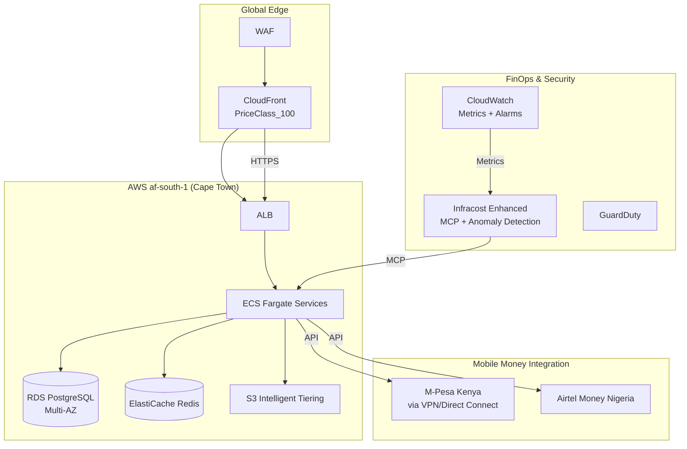
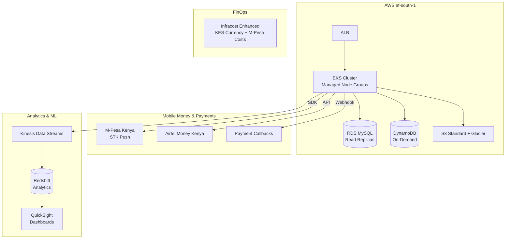
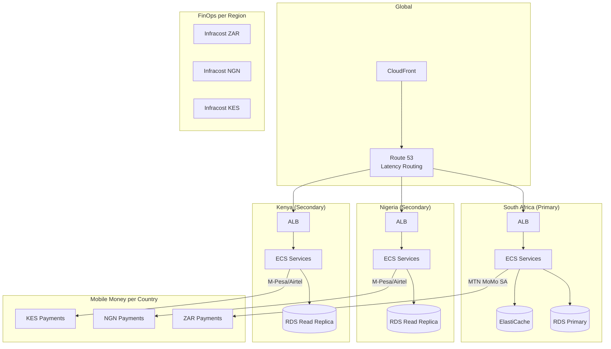

# Infracost Enhanced - African FinOps Guide

## Overview

This guide provides best practices, patterns, and reference architectures for Cloud Financial Operations (FinOps) in African markets using Infracost Enhanced. It covers African cloud regions, local currencies, mobile money integration, cost optimization strategies, and compliance considerations.

## Table of Contents

1. [African Cloud Landscape](#african-cloud-landscape)
2. [Currency Management](#currency-management)
3. [Mobile Money Cost Modeling](#mobile-money-cost-modeling)
4. [Cost Optimization Strategies](#cost-optimization-strategies)
5. [FinOps Security & Anomaly Detection](#finops-security--anomaly-detection)
6. [Compliance & Data Residency](#compliance--data-residency)
7. [Reference Architectures](#reference-architectures)
8. [CI/CD Integration Patterns](#cicd-integration-patterns)

---

## African Cloud Landscape

### Supported Regions

| Provider | Region | Location | Launched | Infracost Support |
|----------|--------|----------|----------|-------------------|
| **AWS** | `af-south-1` | Cape Town, South Africa | 2020 | ✅ Full |
| **Azure** | `southafrica-north` | Johannesburg, South Africa | 2019 | ✅ Full |
| **Azure** | `southafrica-west` | Cape Town, South Africa | 2023 | ✅ Full |
| **GCP** | `africa-south1` | Johannesburg, South Africa | 2024 | ✅ Full |

### Regional Pricing Considerations

| Factor | Impact | Mitigation |
|--------|--------|------------|
| **Premium Pricing** | 15-25% higher than US/EU | Reserved Instances, Savings Plans |
| **Limited Instance Types** | Not all SKUs available | Right-size, use available types |
| **Data Transfer Costs** | Higher inter-region egress | Keep data in-region, use CloudFront/CDN |
| **Support Tiers** | Business/Enterprise required | Plan support costs in budget |

### Regional Strategy Patterns

#### Pattern 1: Single Region (South Africa)
```hcl
# Terraform - Single region deployment
provider "aws" {
  region = "af-south-1"
}

# Infracost usage
infracost breakdown --path ./tf --region af-south-1 --currency ZAR
```

#### Pattern 2: Multi-Region (SA + EU for DR)
```hcl
# Primary in SA, DR in EU
module "primary" {
  source = "./modules/app"
  region = "af-south-1"
}

module "dr" {
  source = "./modules/app"
  region = "eu-west-1"  # Ireland for DR
}

# Cost comparison
infracost breakdown --path ./tf --format json --out-file costs-sa.json
infracost diff --path ./tf --compare-to costs-sa.json
```

#### Pattern 3: Edge + Core (CloudFront + SA Origin)
```hcl
# CloudFront for global edge, SA origin for data residency
resource "aws_cloudfront_distribution" "app" {
  origin {
    domain_name = aws_s3_bucket.app.bucket_regional_domain_name
    origin_id   = "S3-af-south-1"
  }
  price_class = "PriceClass_100"  # Excludes expensive regions
}

# Cost optimization: PriceClass_100 excludes Africa/SA/ME
# But data residency requires SA origin
```

---

## Currency Management

### Supported African Currencies

| Code | Name | Symbol | Countries | Volatility |
|------|------|--------|-----------|------------|
| **NGN** | Nigerian Naira | ₦ | Nigeria | High |
| **KES** | Kenyan Shilling | KSh | Kenya | Medium |
| **ZAR** | South African Rand | R | SA, Namibia, Lesotho, Eswatini | Medium |
| **GHS** | Ghanaian Cedi | ₵ | Ghana | High |
| **UGX** | Ugandan Shilling | USh | Uganda | Medium |
| **XOF** | West African CFA Franc | CFA | 8 WAEMU countries | Low (pegged to EUR) |
| **XAF** | Central African CFA Franc | FCFA | 6 CEMAC countries | Low (pegged to EUR) |
| **EGP** | Egyptian Pound | E£ | Egypt | High |
| **MAD** | Moroccan Dirham | د.م. | Morocco, Western Sahara | Low |
| **TZS** | Tanzanian Shilling | TSh | Tanzania | Medium |

### Currency Configuration

```bash
# CLI usage
infracost breakdown --path ./tf --currency NGN --format table

# Usage file with local currency
# infracost-usage.yml
currency: KES
resources:
  aws_instance.web:
    monthly_hrs: 730
```

### Exchange Rate Strategy

Infracost Enhanced uses **exchangerate.host** (free, no API key) with **24-hour TTL caching**:

```go
// internal/africa/currency.go
converter := africa.NewCurrencyConverter(
    africa.NewFreeExchangeRateProvider(),
    24*time.Hour,  // TTL
)

// Convert with fallback
amount, _ := converter.Convert(ctx, decimal.NewFromFloat(1000), "USD", "NGN")
```

### Best Practices

1. **Budget in Local Currency**: Set budgets in NGN/KES/ZAR for stakeholder clarity
2. **Hedge Volatility**: For high-volatility currencies (NGN, GHS, EGP), use USD-denominated contracts where possible
3. **Report Dual-Currency**: Show both USD (corporate) and local (operational) in reports
4. **Cache Aggressively**: 24h TTL balances freshness with API limits
5. **Fallback Rates**: Reverse rate calculation if direct pair unavailable

### Currency-Aware CI/CD

```yaml
# .github/workflows/finops.yml
jobs:
  cost-check:
    runs-on: ubuntu-latest
    steps:
      - uses: actions/checkout@v4
      - name: Setup Infracost
        run: |
          curl -fsSL https://github.com/nakisisageorge/infracost-enhanced/releases/latest/download/infracost-linux-amd64.tar.gz | tar xz
          sudo mv infracost /usr/local/bin/
      
      - name: Cost Breakdown (Local Currency)
        run: |
          infracost breakdown \
            --path ./terraform \
            --currency ${{ secrets.LOCAL_CURRENCY }} \
            --format json \
            --out-file infracost.json
        env:
          INFRACOST_API_KEY: ${{ secrets.INFRACOST_API_KEY }}
      
      - name: Post PR Comment
        run: |
          infracost comment github \
            --path ./terraform \
            --repo ${{ github.repository }} \
            --pull-request ${{ github.event.pull_request.number }} \
            --currency ${{ secrets.LOCAL_CURRENCY }}
```

---

## Mobile Money Cost Modeling

### Provider Coverage

| Provider | Countries | Currency | USSD | Transaction Types |
|----------|-----------|----------|------|-------------------|
| **M-Pesa Kenya** | Kenya | KES | *334# | All 8 types |
| **M-Pesa Tanzania** | Tanzania | TZS | *150*00# | 7 types |
| **M-Pesa Ghana** | Ghana | GHS | *170# | 6 types |
| **MTN MoMo Uganda** | Uganda | UGX | *165# | 7 types |
| **MTN MoMo Ghana** | Ghana | GHS | *170# | 7 types |
| **MTN MoMo South Africa** | SA | ZAR | *120*151# | 7 types |
| **Airtel Money Nigeria** | Nigeria | NGN | *432# | 7 types |
| **Airtel Money Uganda** | Uganda | UGX | *185*9# | 7 types |
| **Orange Money Ivory Coast** | Ivory Coast | XOF | #144# | 6 types |
| **Wave Senegal** | Senegal | XOF | *808# | 7 types |
| **EcoCash Zimbabwe** | Zimbabwe | USD | *151# | 8 types |

### Transaction Types

| Type | Description | Typical Fee Structure |
|------|-------------|----------------------|
| **deposit** | Cash in (agent/bank) | Free or low % |
| **withdrawal** | Cash out (agent/ATM) | Tiered % + fixed |
| **p2p_transfer** | Person-to-person | Tiered % (often free < threshold) |
| **merchant_payment** | Pay bill/merchant | % of amount |
| **airtime_purchase** | Buy airtime/data | Small fixed or % |
| **bill_payment** | Utilities, TV, etc. | Fixed per bill |
| **bank_transfer** | To/from bank account | % + fixed |
| **international_remit** | Cross-border | Higher % + corridor fee |

### Cost Modeling in Terraform

```hcl
# Custom resource for mobile money costs
resource "infracost_mobile_money" "mpesa_payments" {
  provider         = "mpesa_kenya"
  transaction_type = "p2p_transfer"
  monthly_volume   = 50000
  average_amount   = 2500  # KES
  currency         = "KES"
  
  # Tiered pricing (optional)
  tiered_pricing = [
    { min_volume = 0,     max_volume = 10000, percentage_fee = 1.0, fixed_fee = 5 },
    { min_volume = 10001, max_volume = 50000, percentage_fee = 0.8, fixed_fee = 3 },
    { min_volume = 50001, max_volume = 0,     percentage_fee = 0.5, fixed_fee = 1 }
  ]
}
```

### CLI Usage

```bash
# Estimate mobile money costs
infracost mobile-money estimate \
  --provider mpesa_kenya \
  --transaction-type p2p_transfer \
  --monthly-volume 50000 \
  --average-amount 2500 \
  --currency KES

# List providers
infracost mobile-money providers --country Kenya

# Via MCP (for AI agents)
# "Estimate M-Pesa Kenya P2P transfer costs for 50k transactions/month at 2500 KES average"
```

### MCP Tool Usage

```json
{
  "tool": "get_mobile_money_costs",
  "arguments": {
    "provider": "mpesa_kenya",
    "transaction_type": "p2p_transfer",
    "monthly_volume": 50000,
    "average_amount": 2500
  }
}
```

### Cost Optimization Patterns

#### Pattern 1: Volume Consolidation
```go
// Instead of many small transfers, batch daily
// Tiered pricing: 0-10k: 1%, 10k-50k: 0.8%, 50k+: 0.5%
// Consolidating 50k tx/month saves ~40% vs 10k batches
```

#### Pattern 2: Provider Arbitrage
```go
// Compare providers for same corridor
// M-Pesa Kenya P2P: 0.5-1% | Airtel Kenya P2P: 0.3-0.8%
// Route high-volume corridors to cheaper provider
```

#### Pattern 3: Float Optimization
```go
// Maintain optimal float in agent accounts
// Reduce withdrawal frequency → lower cash-out fees
// Target: 1 withdrawal per 10 deposits
```

---

## Cost Optimization Strategies

### 1. Reserved Instances & Savings Plans

```bash
# Infracost supports RI modeling via usage file
# infracost-usage.yml
resources:
  aws_instance.web:
    reserved_instance_type: "standard"
    reserved_instance_term: "1_year"
    reserved_instance_payment_option: "all_upfront"
```

| Commitment | Discount (vs On-Demand) | Best For |
|------------|------------------------|----------|
| **1yr All Upfront** | 30-40% | Stable workloads, predictable traffic |
| **1yr Partial Upfront** | 25-35% | Moderate cash flow flexibility |
| **1yr No Upfront** | 20-30% | Cash flow constrained |
| **3yr All Upfront** | 50-60% | Very stable, long-term workloads |

### 2. Right-Sizing

```bash
# Infracost shows current vs recommended
infracost breakdown --path ./tf --show-rightsizing

# CPU/Memory utilization analysis
# Use CloudWatch/Cloud Monitoring metrics
# Downsize over-provisioned instances
```

### 3. Spot/Preemptible Instances

```hcl
# For fault-tolerant workloads (batch, CI/CD, dev)
resource "aws_instance" "batch" {
  instance_type = "m5.large"
  spot_price    = "0.03"  # ~70% discount
  
  # Infracost usage
  # infracost-usage.yml:
  #   purchase_option: "spot"
}
```

| Workload Type | Spot Suitability | Savings |
|---------------|------------------|---------|
| Batch processing | ✅ High | 60-90% |
| CI/CD runners | ✅ High | 60-90% |
| Dev/test environments | ✅ High | 60-90% |
| Stateless microservices | ⚠️ Medium | 50-70% |
| Databases | ❌ Low | N/A |

### 4. Storage Tiering

```hcl
# S3 Intelligent Tiering for unknown access patterns
resource "aws_s3_bucket" "data" {
  bucket = "my-data"
  
  lifecycle_rule {
    id      = "tiering"
    status  = "Enabled"
    transition {
      days          = 30
      storage_class = "INTELLIGENT_TIERING"
    }
    transition {
      days          = 90
      storage_class = "GLACIER"
    }
    transition {
      days          = 365
      storage_class = "DEEP_ARCHIVE"
    }
  }
}
```

### 5. Data Transfer Optimization

```hcl
# Use CloudFront for global distribution
# Keep data in-region for residency
# VPC endpoints for AWS services (no NAT gateway cost)

resource "aws_vpc_endpoint" "s3" {
  vpc_id        = aws_vpc.main.id
  service_name  = "com.amazonaws.af-south-1.s3"
  vpc_endpoint_type = "Gateway"
}

resource "aws_vpc_endpoint" "dynamodb" {
  vpc_id        = aws_vpc.main.id
  service_name  = "com.amazonaws.af-south-1.dynamodb"
  vpc_endpoint_type = "Gateway"
}
```

### 6. African Region Specific

| Optimization | Region | Impact |
|--------------|--------|--------|
| **Local DNS** | All | Route 53 latency routing to af-south-1 |
| **Edge Caching** | CloudFront PriceClass_100 | Excludes Africa but reduces global cost |
| **Local Peering** | AWS Direct Connect / Azure ExpressRoute | Reduce egress to on-prem |
| **Regional Services** | Use af-south-1 services | Avoid cross-region data transfer |

---

## FinOps Security & Anomaly Detection

### Anomaly Detection as Security Control

Cost anomalies are often early indicators of security incidents:

| Anomaly Type | Security Indicator | Example |
|--------------|-------------------|---------|
| **Sudden Spike** | Cryptojacking, compromised credentials | EC2 costs jump 500% overnight |
| **Gradual Creep** | Data exfiltration, unauthorized storage | S3 costs grow 20%/month consistently |
| **Unused Resources** | Abandoned infrastructure, shadow IT | Orphaned ELBs, unattached EBS |
| **New Resource Types** | Unauthorized service deployment | Sudden Lambda, KMS, GuardDuty charges |

### Infracost Anomaly Detection

```bash
# Detect anomalies from cost history
infracost anomaly detect \
  --cost-data costs-history.json \
  --z-threshold 3.0 \
  --creep-threshold 0.15 \
  --format json

# CI/CD gate
infracost anomaly detect \
  --cost-data costs.json \
  --ci-mode \
  --fail-on high
```

### Detection Algorithms

```go
// internal/anomaly/detector.go

// 1. Z-Score (Sudden Spikes)
// Threshold: 3.0 (configurable)
// Flags: cost > mean + 3σ or IQR outlier

// 2. IQR (Outliers)
// Q1 - 1.5×IQR to Q3 + 1.5×IQR
// Robust to non-normal distributions

// 3. Linear Regression (Gradual Creep)
// Monthly growth rate > 15% (configurable)
// Projects 30-day forward cost

// 4. Unused Resources
// All daily costs < $1 over 30 days
// Identifies orphaned resources
```

### CI/CD Integration

```yaml
# .github/workflows/finops-security.yml
name: FinOps Security Gate
on:
  pull_request:
    types: [opened, synchronize, reopened]
  schedule:
    - cron: '0 6 * * *'  # Daily at 6 AM

jobs:
  anomaly-detection:
    runs-on: ubuntu-latest
    steps:
      - uses: actions/checkout@v4
      
      - name: Setup Infracost
        run: |
          curl -fsSL https://github.com/nakisisageorge/infracost-enhanced/releases/latest/download/infracost-linux-amd64.tar.gz | tar xz
          sudo mv infracost /usr/local/bin/
      
      - name: Fetch Cost History
        run: |
          # Pull last 30 days from Infracost Cloud or local storage
          aws s3 cp s3://my-finops-bucket/cost-history/ ./cost-history/ --recursive
      
      - name: Run Anomaly Detection
        run: |
          infracost anomaly detect \
            --cost-data ./cost-history/latest.json \
            --z-threshold 3.0 \
            --creep-threshold 0.15 \
            --ci-mode \
            --fail-on high \
            --format json > anomaly-report.json
      
      - name: Upload Report
        uses: actions/upload-artifact@v4
        with:
          name: anomaly-report
          path: anomaly-report.json
      
      - name: Alert on Critical
        if: failure()
        run: |
          # Send to Slack, PagerDuty, email
          curl -X POST ${{ secrets.SLACK_WEBHOOK }} \
            -d '{"text": "🚨 Critical cost anomaly detected in PR #${{ github.event.pull_request.number }}"}'
```

### Severity Response Matrix

| Severity | Response Time | Action |
|----------|---------------|--------|
| **Critical** | < 1 hour | Page on-call, investigate immediately, consider resource shutdown |
| **High** | < 4 hours | Assign to team, investigate root cause, plan remediation |
| **Medium** | < 24 hours | Log ticket, investigate next sprint |
| **Low** | < 1 week | Review in monthly FinOps meeting |

---

## Compliance & Data Residency

### African Data Protection Laws

| Country | Law | Key Requirements | Cloud Impact |
|---------|-----|------------------|--------------|
| **South Africa** | POPIA (2020) | Consent, purpose limitation, security safeguards | Data must stay in SA or adequate jurisdiction |
| **Nigeria** | NDPR (2019) | Consent, data localization for critical sectors | Financial/health data in NG |
| **Kenya** | Data Protection Act (2019) | Consent, localization for sensitive data | Personal data in KE |
| **Ghana** | Data Protection Act (2012) | Registration, consent, security | Data in GH |
| **Egypt** | Data Protection Law (2020) | Localization for government data | Gov data in EG |
| **Morocco** | Law 09-08 | Consent, DPO required, localization | Personal data in MA |

### Data Residency Patterns

```hcl
# Pattern 1: Strict Residency (POPIA/NDPR compliance)
provider "aws" {
  region = "af-south-1"  # All resources in SA
}

# Validate no cross-region resources
data "aws_availability_zones" "sa" {
  filter {
    name   = "region-name"
    values = ["af-south-1"]
  }
}

# Pattern 2: Hybrid (Core in SA, Edge Global)
module "core" {
  source  = "./modules/core"
  region  = "af-south-1"  # Data residency
}

module "edge" {
  source  = "./modules/edge"
  # CloudFront global, but origin in SA
  origin_region = "af-south-1"
}

# Pattern 3: Sector-Specific (Financial Services)
# NDPR requires financial data in Nigeria
provider "aws" {
  alias  = "nigeria"
  region = "af-south-1"  # Closest AWS region
  # Note: No AWS region in Nigeria yet
  # Use Azure southafrica-north or on-prem for strict NDPR
}
```

### Infracost Compliance Checks

```bash
# Check for cross-region resources
infracost breakdown --path ./tf \
  --format json | jq '.projects[].resources[] | select(.provider != "aws" or .region != "af-south-1")'

# Validate data residency in CI/CD
infracost breakdown --path ./tf --format json \
  | jq -r '.projects[].resources[] | "\(.name) \(.provider) \(.region)"' \
  | grep -v "af-south-1" && exit 1 || echo "✅ All resources in af-south-1"
```

---

## Reference Architectures

### Architecture 1: FinTech Platform (Nigeria)



**Cost Profile (Monthly, NGN):**
- Compute (ECS Fargate): ₦2.5M
- Database (RDS): ₦1.8M
- Cache (ElastiCache): ₦800K
- Storage (S3): ₦300K
- Data Transfer: ₦500K
- **Total: ~₦5.9M/month**

### Architecture 2: E-Commerce Marketplace (Kenya)



**Cost Profile (Monthly, KES):**
- Compute (EKS): KSh 4.2M
- Database (RDS + DynamoDB): KSh 2.1M
- Streaming (Kinesis): KSh 600K
- Analytics (Redshift): KSh 1.5M
- Mobile Money Fees: KSh 800K
- **Total: ~KSh 9.2M/month**

### Architecture 3: Pan-African SaaS (Multi-Country)



**Cost Profile (Monthly, USD Equivalent):**
- South Africa (Primary): $45,000
- Nigeria (Secondary): $28,000
- Kenya (Secondary): $22,000
- Data Transfer (Cross-region): $8,000
- **Total: ~$103,000/month**

---

## CI/CD Integration Patterns

### Pattern 1: PR Cost Gate with Local Currency

```yaml
# .github/workflows/pr-cost-gate.yml
name: PR Cost Gate (ZAR)
on:
  pull_request:
    types: [opened, synchronize, reopened]

jobs:
  cost-gate:
    runs-on: ubuntu-latest
    steps:
      - uses: actions/checkout@v4
      
      - name: Setup Infracost
        run: |
          curl -fsSL https://github.com/nakisisageorge/infracost-enhanced/releases/latest/download/infracost-linux-amd64.tar.gz | tar xz
          sudo mv infracost /usr/local/bin/
      
      - name: Generate Baseline
        run: |
          infracost breakdown \
            --path ./terraform \
            --currency ZAR \
            --format json \
            --out-file infracost-base.json
      
      - name: Post PR Comment
        run: |
          infracost comment github \
            --path ./terraform \
            --repo ${{ github.repository }} \
            --pull-request ${{ github.event.pull_request.number }} \
            --currency ZAR \
            --format table
        env:
          INFRACOST_API_KEY: ${{ secrets.INFRACOST_API_KEY }}
          GITHUB_TOKEN: ${{ secrets.GITHUB_TOKEN }}
      
      - name: Fail if Cost Increase > 10%
        run: |
          # Custom script to compare and fail
          python3 scripts/check_cost_increase.py \
            --baseline infracost-base.json \
            --threshold 10 \
            --currency ZAR
```

### Pattern 2: Daily FinOps Dashboard Update

```yaml
# .github/workflows/daily-finops.yml
name: Daily FinOps Update
on:
  schedule:
    - cron: '0 6 * * *'  # 6 AM UTC daily
  workflow_dispatch:

jobs:
  finops-dashboard:
    runs-on: ubuntu-latest
    steps:
      - uses: actions/checkout@v4
      
      - name: Setup Infracost
        run: |
          curl -fsSL https://github.com/nakisisageorge/infracost-enhanced/releases/latest/download/infracost-linux-amd64.tar.gz | tar xz
          sudo mv infracost /usr/local/bin/
      
      - name: Generate Cost Reports (All Currencies)
        run: |
          for currency in USD NGN KES ZAR GHS UGX; do
            infracost breakdown \
              --path ./terraform \
              --currency $currency \
              --format json \
              --out-file "costs-${currency}.json"
          done
      
      - name: Run Anomaly Detection
        run: |
          infracost anomaly detect \
            --cost-data costs-USD.json \
            --ci-mode \
            --fail-on high \
            --format json > anomaly-report.json || true
      
      - name: Run Benchmarks
        run: |
          infracost benchmark run --compare-baseline --format json > benchmark-report.json
      
      - name: Upload to FinOps Dashboard
        run: |
          # Upload to S3/GCS for dashboard consumption
          aws s3 sync ./costs-* s3://my-finops-dashboard/daily/$(date +%Y-%m-%d)/
          aws s3 cp anomaly-report.json s3://my-finops-dashboard/anomalies/
          aws s3 cp benchmark-report.json s3://my-finops-dashboard/benchmarks/
      
      - name: Alert on Anomalies
        if: failure()
        run: |
          curl -X POST ${{ secrets.SLACK_WEBHOOK }} \
            -d '{"text": "🚨 Daily FinOps: Cost anomalies detected"}'
```

### Pattern 3: MCP-Enabled AI Agent in CI/CD

```yaml
# .github/workflows/ai-finops-review.yml
name: AI FinOps Review
on:
  pull_request:
    types: [opened, synchronize]

jobs:
  ai-review:
    runs-on: ubuntu-latest
    steps:
      - uses: actions/checkout@v4
      
      - name: Setup Infracost MCP
        run: |
          curl -fsSL https://github.com/nakisisageorge/infracost-enhanced/releases/latest/download/infracost-linux-amd64.tar.gz | tar xz
          sudo mv infracost /usr/local/bin/
          # Start MCP server in background
          infracost mcp stdio > mcp.log 2>&1 &
          echo $! > mcp.pid
      
      - name: AI Cost Analysis
        run: |
          # Use Claude Code / Cursor via MCP to analyze costs
          # Example prompt for AI agent:
          cat > ai-prompt.txt << 'EOF'
          Analyze the Terraform in ./terraform for:
          1. Cost optimization opportunities in African regions
          2. Mobile money integration costs for M-Pesa Kenya
          3. Currency risk for NGN/KES/ZAR budgets
          4. Reserved Instance recommendations
          5. Data transfer cost optimization
          EOF
          
          # Run AI agent with MCP access
          claude-code --mcp-config mcp-config.json -p "$(cat ai-prompt.txt)" \
            > ai-analysis.md
      
      - name: Post AI Analysis as PR Comment
        run: |
          gh pr comment ${{ github.event.pull_request.number }} \
            --body-file ai-analysis.md
        env:
          GITHUB_TOKEN: ${{ secrets.GITHUB_TOKEN }}
      
      - name: Cleanup MCP Server
        if: always()
        run: |
          kill $(cat mcp.pid) 2>/dev/null || true
```

---

## MCP Integration for African FinOps

### Natural Language Cost Queries

With Infracost Enhanced MCP server, AI agents can answer:

> **"What's the monthly cost of deploying our Terraform to AWS Cape Town in Nigerian Naira?"**

```json
{
  "tool": "get_cost_estimate",
  "arguments": {
    "path": "./terraform",
    "format": "terraform",
    "currency": "NGN",
    "show_skipped": true
  }
}
```

> **"Estimate M-Pesa Kenya transaction fees for 100k monthly P2P transfers averaging 3000 KES"**

```json
{
  "tool": "get_mobile_money_costs",
  "arguments": {
    "provider": "mpesa_kenya",
    "transaction_type": "p2p_transfer",
    "monthly_volume": 100000,
    "average_amount": 3000
  }
}
```

> **"Convert our $50k monthly AWS budget to South African Rand"**

```json
{
  "tool": "convert_currency",
  "arguments": {
    "amount": 50000,
    "from": "USD",
    "to": "ZAR"
  }
}
```

> **"Run anomaly detection on our last 30 days of costs"**

```json
{
  "tool": "detect_cost_anomalies",
  "arguments": {
    "cost_data": [...],
    "z_score_threshold": 3.0,
    "creep_threshold": 0.15
  }
}
```

### FinOps Prompts

> **"Generate FinOps analysis for Azure South Africa North in ZAR"**

```json
{
  "prompt": "african_finops_analysis",
  "arguments": {
    "provider": "azure",
    "region": "southafrica-north",
    "currency": "ZAR"
  }
}
```

> **"Optimize mobile money costs for Wave Senegal with 50k monthly transactions"**

```json
{
  "prompt": "mobile_money_cost_optimization",
  "arguments": {
    "provider": "wave_senegal",
    "monthly_volume": "50000",
    "avg_amount": "2500"
  }
}
```

---

## Monitoring & Alerting

### Key Metrics to Track

| Metric | Target | Alert Threshold |
|--------|--------|-----------------|
| **Monthly Cloud Spend** | Budget ±5% | >110% of budget |
| **Cost per Transaction** | Decreasing trend | >120% of 30-day avg |
| **Mobile Money Fee %** | <2% of revenue | >3% |
| **Reserved Instance Utilization** | >80% | <70% |
| **Spot Instance Coverage** | >30% of flexible workloads | <20% |
| **Anomaly Count (High/Critical)** | 0 | >0 |
| **Benchmark Regression** | 0% | >5% |

### Grafana Dashboard Queries

```promql
# Monthly spend by currency
sum by (currency) (rate(infracost_monthly_spend[30d]))

# Cost anomaly rate
rate(infracost_anomalies_detected_total{severity=~"high|critical"}[1h])

# Mobile money fee ratio
infracost_mobile_money_fees / infracost_revenue * 100

# RI utilization
infracost_ri_utilization_percent

# Benchmark performance
infracost_benchmark_ns_per_op{benchmark="CostCalculation"}
```

---

## Conclusion

Infracost Enhanced provides the tooling foundation for African FinOps:

1. **Accurate Cost Estimation** in local currencies for African cloud regions
2. **Mobile Money Cost Modeling** for FinTech applications
3. **AI Agent Integration** via MCP for natural language FinOps
4. **Anomaly Detection** as FinOps security control
5. **Performance Governance** via benchmark regression detection
6. **Compliance Support** for data residency requirements

### Getting Started Checklist

- [ ] Deploy Infracost Enhanced binary
- [ ] Configure African cloud regions in Terraform
- [ ] Set local currency in usage files
- [ ] Model mobile money costs for FinTech integrations
- [ ] Enable MCP server for AI agent access
- [ ] Add anomaly detection to CI/CD pipeline
- [ ] Run benchmarks and establish baselines
- [ ] Configure FinOps dashboard with local currency views
- [ ] Set up compliance checks for data residency
- [ ] Train team on African FinOps best practices

---

*African FinOps Guide for Infracost Enhanced. Part of the documentation suite.*