# Infracost Enhanced - Architecture Documentation

## Overview

This document provides an interactive and static view of the Infracost Enhanced architecture. The interactive visualization is available at the [Architecture Visualization](#interactive-visualization) section below.

## Interactive Visualization

The interactive architecture diagram is built with React Flow and provides:

- **22 nodes** across 8 categories
- **30+ edges** showing data flow
- **Side panel** with component details on click
- **Connected component navigation** 
- **8 view modes** (All, CLI, API, Parser, Engine, Service, UI, External)
- **Legend**, minimap, zoom controls
- **Responsive design** (desktop + mobile)

### Accessing the Visualization

1. **Online**: https://nakisisageorge.github.io/infracost-enhanced/architecture/
2. **Local**: 
   ```bash
   cd architecture-viz && npm run dev
   # Opens at http://localhost:3000
   ```
3. **Embedded**: The diagram can be embedded in any HTML page via iframe

## Architecture Categories

### 🟦 CLI Layer (2 nodes)
- **CLI Commands**: Main entry point (breakdown, diff, output, comment, mcp, configure, auth)
- **MCP Server (stdio)**: Model Context Protocol for local AI agents (Claude Code, Cursor)

### 🟦 API & Auth (2 nodes)
- **Config Manager**: Viper-based configuration from env vars, files, CLI flags; Cloud settings sync
- **Auth & API Client**: API key management, pricing API client, dashboard API client

### 🟪 Parsers (3 nodes)
- **Terraform Parser**: HCL2, Terragrunt, plan JSON, state JSON, reference resolution
- **CloudFormation Parser**: Template parsing with intrinsic functions
- **Kubernetes Parser**: Manifest parsing, Helm, Kustomize

### 🟩 Core Engine (2 nodes)
- **Cost Calculation Engine**: Resource cost components, usage estimation, aggregation
- **Usage Estimator**: Default usage values, estimation functions, usage file parsing

### 🟧 Services (6 nodes)
- **African Cloud Regions**: AWS af-south-1, Azure southafrica-north/west, GCP africa-south1
- **African Currency Support**: 10 currencies (NGN, KES, ZAR, GHS, UGX, XOF, XAF, EGP, MAD, TZS)
- **Mobile Money Cost Models**: 12+ providers, 8 transaction types, tiered pricing
- **Cost Anomaly Detector**: Z-score, IQR, gradual creep, unused resource detection
- **MCP Server (HTTP/SSE)**: Remote AI agent access, session management, rate limiting
- **Benchmark & Regression**: Performance benchmarks with regression detection

### 🟫 External (1 node)
- **Infracost Pricing API**: Cloud pricing data (AWS, Azure, GCP + African regions)

### 🟪 UI & Output (3 nodes)
- **Output Formatters**: Table, JSON, HTML, CSV with cost breakdowns and diffs
- **CI/CD Integration**: GitHub, GitLab, Bitbucket, Azure Repos PR comments
- **Architecture Visualization**: Interactive React Flow diagram

## Data Flow

```
┌─────────────┐     ┌──────────────┐     ┌─────────────────┐
│   CLI /     │────▶│  Config &    │────▶│  Parsers (TF/   │
│   MCP stdin │     │  Auth        │     │  CFN/K8s)       │
└─────────────┘     └──────────────┘     └────────┬────────┘
                                                   │
                                                   ▼
┌─────────────┐     ┌──────────────┐     ┌─────────────────┐
│   Output    │◀────│  Cost Engine │◀────│  African        │
│   Formatters│     │  + Anomaly   │     │  Enhancements   │
└─────────────┘     └──────┬───────┘     └────────┬────────┘
                           │                      │
                    ┌──────▼──────┐       ┌────────▼────────┐
                    │ Pricing API │       │ Exchange Rate   │
                    │ (AWS/AZ/GCP)│       │ API + Cache     │
                    └─────────────┘       └─────────────────┘
```

### Detailed Data Flow Steps

1. **Input**: User runs CLI command or MCP tool call
2. **Configuration**: Config Manager loads settings (env, file, flags, cloud sync)
3. **Authentication**: Auth client provides API keys to pricing/dashboard APIs
4. **Parsing**: Appropriate parser (TF/CFN/K8s) extracts resource graph
5. **African Enhancement**: 
   - Region mapping (af-south-1, southafrica-north, africa-south1)
   - Currency conversion (USD → NGN/KES/ZAR/etc. via cached rates)
   - Mobile money cost modeling (if resources present)
6. **Cost Calculation**: Engine computes cost components, aggregates monthly/hourly
7. **Anomaly Detection**: Optional statistical analysis on cost patterns
8. **Pricing API**: Batch queries for resource pricing (with African region support)
9. **Exchange Rate**: Live rates from exchangerate.host (24h cache)
10. **Output**: Formatted as table/JSON/HTML/CSV or MCP tool response

## Component Details

### Cost Calculation Engine (`internal/schema/`, `internal/prices/`)
- **Resource Graph**: Hierarchical resources with sub-resources
- **Cost Components**: Per-resource cost breakdown (compute, storage, network, etc.)
- **Usage Estimation**: Default values + usage file overrides
- **Aggregation**: Hourly → Monthly (730h multiplier), sub-resource rollup
- **Currency**: Decimal arithmetic throughout, conversion at output

### African Enhancements (`internal/africa/`)
- **Regions** (`regions.go`): Provider→region mapping, validation, fallback
- **Currency** (`currency.go`): 10 African currencies, live rates, 24h cache, formatting
- **Mobile Money** (`mobile_money.go`): 12+ providers, 8 tx types, tiered pricing

### Anomaly Detection (`internal/anomaly/detector.go`)
- **Z-Score**: Mean ± 3σ threshold for sudden spikes
- **IQR**: Q1-1.5×IQR to Q3+1.5×IQR for outliers
- **Linear Regression**: Slope-based gradual creep detection (15%/month)
- **Unused Resources**: All costs < $1/month over 30 days
- **Severity**: Low/Medium/High/Critical based on deviation magnitude

### MCP Server (`internal/mcp/server.go`)
- **Transports**: stdio (local), HTTP/SSE (remote)
- **Protocol**: JSON-RPC 2.0 over both transports
- **Tools** (7): cost estimate, African regions, currency convert, mobile money, anomalies, benchmarks, provider list
- **Resources** (3): regions, currencies, providers (read-only)
- **Prompts** (2): FinOps analysis, mobile money optimization
- **Security**: Rate limiting (100/10sec), session management, optional API keys

### Benchmark Suite (`internal/benchmark/benchmark.go`)
- **Benchmarks** (8): CostCalculation, CurrencyConversion, AnomalyDetection, MobileMoneyCostCalc, PricingAPIQuery, ResourceParsing, CostAggregation
- **Runner**: Configurable iterations, warmup, duration-based
- **Regression**: 5% ns/op threshold, git-tracked baselines
- **Reports**: JSON + HTML with comparison tables

## Technology Stack

| Layer | Technologies |
|-------|--------------|
| **Core CLI** | Go 1.21+, Cobra, Viper, shopspring/decimal |
| **Parsing** | HCL2, goformation, controller-runtime, kustomize |
| **African Enhancements** | Go, exchangerate.host API, custom domain models |
| **Anomaly Detection** | Go, statistics (Z-score, IQR, linear regression) |
| **MCP Server** | Go, JSON-RPC 2.0, HTTP/SSE, Gorilla WebSocket |
| **Benchmarking** | Go testing, custom runner, baseline persistence |
| **Visualization** | React 18, React Flow 11, TypeScript 5, Vite 5 |
| **CI/CD** | GitHub Actions, Goreleaser, golangci-lint, govulncheck, TruffleHog, Syft |
| **Documentation** | Markdown, Mermaid, React Flow embed |

## Deployment Architecture

### Binary Distribution
```
Goreleaser → Multi-platform builds
├── linux/amd64
├── linux/arm64
├── darwin/amd64
├── darwin/arm64
└── windows/amd64
     │
     ├── Homebrew (macOS)
     ├── Scoop (Windows)
     ├── APT (Debian/Ubuntu)
     ├── RPM (RHEL/Fedora)
     └── Docker (distroless, Wolfi)
```

### MCP Server Deployment
```
Local (stdio)          Remote (HTTP/SSE)
┌──────────────┐       ┌─────────────────────┐
│ infracost    │       │ Docker:             │
│ mcp stdio    │       │   infracost mcp     │
│              │       │   http --port 8080  │
│ Claude Code  │       │                     │
│ Cursor       │       │ K8s: Deployment +   │
│ Continue     │       │   Service + Ingress │
└──────────────┘       └─────────────────────┘
```

### Architecture Visualization Deployment
```bash
cd architecture-viz
npm run build
# Deploy dist/ to:
# - GitHub Pages (nakisisageorge.github.io/infracost-enhanced/architecture/)
# - Vercel (vercel.app)
# - Netlify (netlify.app)
# - Cloudflare Pages (pages.dev)
```

## Security Architecture

### Defense in Depth
1. **Input Validation**: All MCP tools, CLI flags, API inputs
2. **Rate Limiting**: Token bucket (MCP: 100/10sec, Pricing: 1000 batch/16 workers)
3. **Authentication**: Infracost API key + optional MCP API keys
4. **Session Management**: TTL-based, in-memory (extensible to Redis)
5. **Supply Chain**: govulncheck, SBOM (Syft), TruffleHog, Dependency Review
6. **Secrets**: No secrets in logs, outputs, git (pre-commit hooks)

### Threat Model
| Threat | Mitigation |
|--------|------------|
| Injection via MCP tools | Input validation, structured schemas |
| DoS via MCP HTTP | Rate limiting (100 req/10sec) |
| Credential theft | No secrets in logs, pre-commit hooks |
| Supply chain attack | govulncheck, SBOM, signed releases |
| Cost data exfiltration | No external calls except pricing/exchange APIs |

## Scalability Considerations

### Horizontal Scaling
- **MCP HTTP**: Stateless, session in memory (Redis for multi-instance)
- **Pricing API Client**: Connection pooling, batch requests
- **Cost Engine**: Pure functions, no shared state

### Large Projects
- **Streaming Parsing**: For Terraform plans >1000 resources
- **Incremental Calculation**: Only changed resources re-costed
- **Progress Reporting**: CLI spinner, MCP progress notifications

### Multi-Tenant
- **Per-org API Keys**: Pricing API keys per organization
- **Cost Tagging**: All cost data tagged with org ID
- **Anomaly Isolation**: Per-tenant anomaly detection

## Monitoring & Observability

### Metrics (Prometheus)
- `infracost_requests_total` - CLI/MCP request count
- `infracost_pricing_api_duration_seconds` - Pricing API latency
- `infracost_anomalies_detected_total` - Anomaly count by severity
- `infracost_benchmark_ns_per_op` - Benchmark performance

### Logging
- Structured JSON logging (zerolog)
- Levels: trace, debug, info, warn, error, fatal
- Correlation IDs for request tracing

### Health Checks
- `GET /health` on MCP HTTP server
- Pricing API connectivity check on startup
- Exchange rate API connectivity check

## Future Architecture Evolution

### Planned Additions (2027)
1. **Actual Cost Integration**: AWS CUR, Azure Cost Management, GCP Billing Export
2. **ML Forecasting**: Prophet/ARIMA on historical cost data
3. **Policy Engine**: OPA/Rego for cost governance
4. **Multi-org SaaS**: RBAC, billing, white-label

### Architecture Principles
1. **Modularity**: New features in separate packages
2. **Extensibility**: Plugin interfaces for parsers, cost models, outputs
3. **Observability**: Metrics, logs, traces built-in
4. **Security**: Defense in depth, supply chain verification
5. **Backward Compatibility**: No breaking changes to CLI/API

---

## Static Architecture Diagram (Mermaid)

```mermaid
flowchart TB
    subgraph CLI["CLI Layer"]
        CLI_CMD["CLI Commands\n(breakdown, diff, output,\ncomment, mcp, configure, auth)"]
        MCP_STDIO["MCP Server (stdio)\nLocal AI Agents"]
    end

    subgraph CONFIG["Config & Auth"]
        CONFIG_MGR["Config Manager\n(Viper: env, file, flags, cloud)"]
        AUTH["Auth & API Client\n(Pricing API, Dashboard API)"]
    end

    subgraph PARSERS["Parsers"]
        TF["Terraform Parser\n(HCL2, Terragrunt, plan/state JSON)"]
        CFN["CloudFormation Parser\n(goformation, intrinsic functions)"]
        K8S["Kubernetes Parser\n(controller-runtime, Helm, Kustomize)"]
    end

    subgraph ENGINE["Cost Engine"]
        COST_ENGINE["Cost Calculation Engine\n(components, usage, aggregation)"]
        USAGE["Usage Estimator\n(defaults, usage files, estimation)"]
    end

    subgraph AFRICA["African Enhancements"]
        REGIONS["African Cloud Regions\n(5 regions, 3 providers)"]
        CURRENCY["African Currency Support\n(10 currencies, live rates)"]
        MOBILE["Mobile Money Cost Models\n(12+ providers, 8 tx types)"]
    end

    subgraph SERVICES["Services"]
        ANOMALY["Cost Anomaly Detector\n(Z-score, IQR, regression, unused)"]
        MCP_HTTP["MCP Server (HTTP/SSE)\nRemote AI Agents"]
        BENCH["Benchmark & Regression\n(8 benchmarks, 5% threshold)"]
    end

    subgraph EXTERNAL["External Services"]
        PRICING_API["Infracost Pricing API\n(AWS, Azure, GCP + Africa)"]
        EXCHANGE["Exchange Rate API\n(exchangerate.host, 24h cache)"]
    end

    subgraph OUTPUT["UI & Output"]
        FORMATTERS["Output Formatters\n(table, JSON, HTML, CSV)"]
        CICD["CI/CD Integration\n(GitHub, GitLab, Bitbucket, Azure)"]
        VIZ["Architecture Visualization\n(React Flow, interactive)"]
    end

    CLI_CMD --> CONFIG_MGR
    CLI_CMD --> AUTH
    MCP_STDIO --> CONFIG_MGR
    CLI_CMD --> TF
    CLI_CMD --> CFN
    CLI_CMD --> K8S
    TF --> COST_ENGINE
    CFN --> COST_ENGINE
    K8S --> COST_ENGINE
    COST_ENGINE --> USAGE
    COST_ENGINE --> REGIONS
    COST_ENGINE --> CURRENCY
    COST_ENGINE --> MOBILE
    COST_ENGINE --> ANOMALY
    AUTH --> PRICING_API
    COST_ENGINE --> PRICING_API
    CURRENCY --> EXCHANGE
    COST_ENGINE --> FORMATTERS
    FORMATTERS --> CICD
    CLI_CMD --> MCP_HTTP
    MCP_HTTP --> COST_ENGINE
    MCP_HTTP --> CURRENCY
    MCP_HTTP --> MOBILE
    MCP_HTTP --> ANOMALY
    MCP_HTTP --> BENCH
    COST_ENGINE --> BENCH
    CURRENCY --> BENCH
    CLI_CMD --> VIZ

    style CLI fill:#3b82f6,color:#fff
    style CONFIG fill:#06b6d4,color:#fff
    style PARSERS fill:#a855f7,color:#fff
    style ENGINE fill:#22c55e,color:#fff
    style AFRICA fill:#f97316,color:#fff
    style SERVICES fill:#f97316,color:#fff
    style EXTERNAL fill:#64748b,color:#fff
    style OUTPUT fill:#ec4899,color:#fff
```



---

*Architecture documentation for Infracost Enhanced. Interactive version available at [GitHub Pages](https://nakisisageorge.github.io/infracost-enhanced/architecture/).*